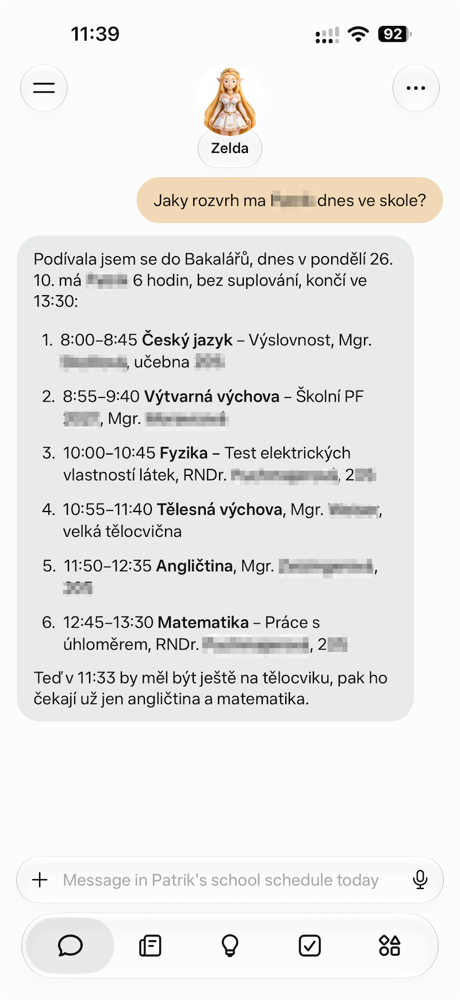
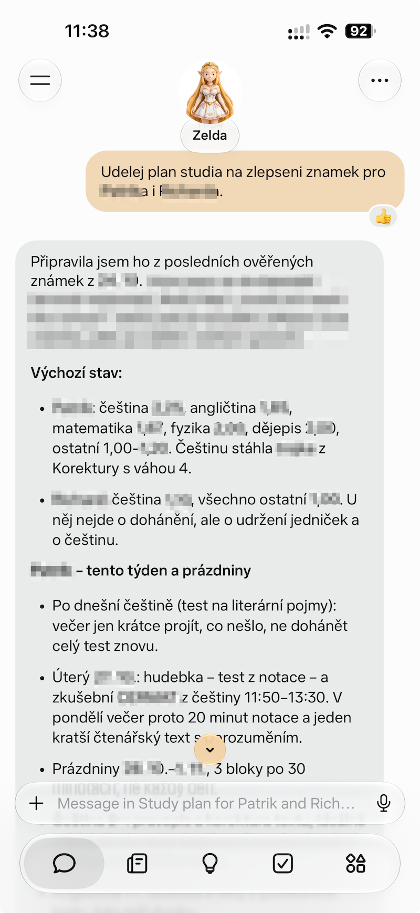
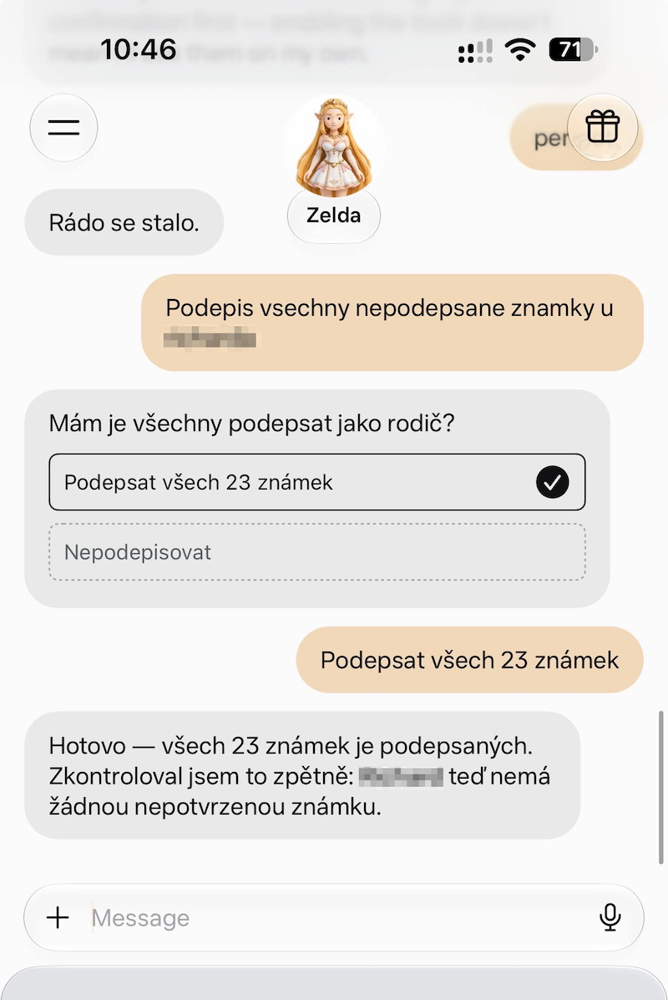
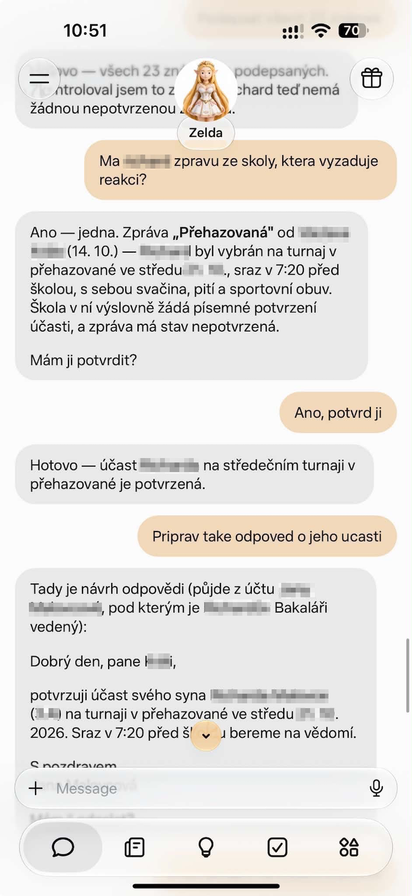

# Bakaláři with an AI assistant: real examples

[Project overview](../README.md) · [MCP setup](mcp.md#connect-an-mcp-host) · [Tool catalog](mcp.md#tool-catalog)

You can ask about school in ordinary Czech or English. The assistant uses the Bakaláři MCP tools to fetch
the relevant data, then turns it into a readable answer or helps you carry out an action. These four real
conversations show what that looks like. The prompts below are reusable examples; replace `[child]` or
`[dítě]` with the child whose account you connected.

The screenshots show one assistant's interface; your host's appearance and approval controls may differ.
Summaries, reply drafts and study plans are generated by the assistant from the available school data.
Click a screenshot to open the original at full size.

| Example | What you can do | Access needed |
|---|---|---|
| [Today's timetable](#todays-timetable) | See lessons, times, rooms and changes | Read tools |
| [A practical study plan](#a-practical-study-plan) | Turn marks and upcoming work into priorities | Read tools |
| [Sign unconfirmed marks](#sign-unconfirmed-marks) | Review and acknowledge marks as a parent | Write tools for signing |
| [School messages and replies](#school-messages-and-replies) | Find messages needing attention, acknowledge and draft a reply | Read tools for reading/drafting; write tools for acknowledging/sending |

## Today's timetable

**Try asking:**

> Jaký rozvrh má dnes [dítě] ve škole? Je nějaké suplování a v kolik končí?

> What lessons does [child] have today? Are there any substitutions, and when does school finish?

The screenshot shows a daily overview with six lessons, their times, teachers and rooms, plus a quick
summary of which lessons remain. The assistant can use `actual_timetable` and `substitutions`, selecting
today's entries from the returned data. This works with the default read tools.

[Timetable tool examples](mcp.md#plan-a-week-of-lessons-and-events)

## A practical study plan

**Try asking:**

> Podívej se na poslední známky a úkoly pro [dítě]. Navrhni plán učení na tento týden s krátkými bloky procvičování.

> Review [child]'s latest marks and homework. Suggest a study plan for this week with short practice sessions.

The screenshot shows a plan for two children, starting with their current marks and suggesting where to
focus practice. For a similar request, the assistant can combine `marks`, `homeworks` and `actual_timetable`
to suggest priorities and fit study sessions around school. The plan is the assistant's suggestion; it does
not change school records.

For more than one child, [configure a separate account connection for each](mcp.md#use-multiple-accounts)
and specify which child each part of the plan is for.

[Marks and averages](mcp.md#review-marks-and-predict-an-average) · [Homework checklist](mcp.md#make-a-homework-checklist)

## Sign unconfirmed marks

**Try asking:**

> Ukaž mi všechny nepodepsané známky pro [dítě]. Před podepsáním si vyžádej moje potvrzení.

> Show all unconfirmed marks for [child]. Ask for my confirmation before signing them.

The screenshot shows the assistant asking whether to sign 23 marks, receiving approval, and then checking
that no unconfirmed marks remain. A similar workflow reads `marks`, uses `confirm_marks` after approval,
and reads the marks again to verify the result. Signing acknowledges the marks; it does not change their values.

This requires a permitted account, typically a parent account, and [write tools enabled](mcp.md#enable-write-tools).
The approval interaction shown belongs to the assistant; `--allow-writes` enables the server's write tools
but does not itself provide a confirmation dialog.

## School messages and replies

**Try asking:**

> Má [dítě] nějakou zprávu ze školy, která vyžaduje reakci? Shrň ji a připrav návrh odpovědi. Před potvrzením nebo odesláním se mě zeptej.

> Does [child] have a school message that needs a response? Summarize it and draft a reply. Ask me before acknowledging or sending anything.

The screenshot shows the assistant finding a tournament message that needs attention, summarizing the
arrangements, acknowledging it after the user's approval, and preparing a written reply for review.

The assistant can use `messages` and `message` to read the content without marking it read. Drafting a reply
also needs only read access. `confirm_message` acknowledges receipt; `reply_to_message` sends a written reply.
Acknowledging receipt is separate from sending the school a requested written confirmation of participation.
The screenshot shows a reply draft, not evidence that the reply was sent.

Acknowledging or sending requires [write tools enabled](mcp.md#enable-write-tools) and the school's permission
for that message. Review the intended account, recipient and reply before authorizing the action.

[Message and reply workflow](mcp.md#reply-acknowledge-hide-or-delete-a-message)

## Try it with your account

Follow the [MCP host setup](mcp.md#connect-an-mcp-host), then ask “Which school account is connected?” before
trying one of the prompts above. Reading timetables, marks and messages works without write tools. To enable
actions such as signing marks or replying, follow [Enable write tools](mcp.md#enable-write-tools).
